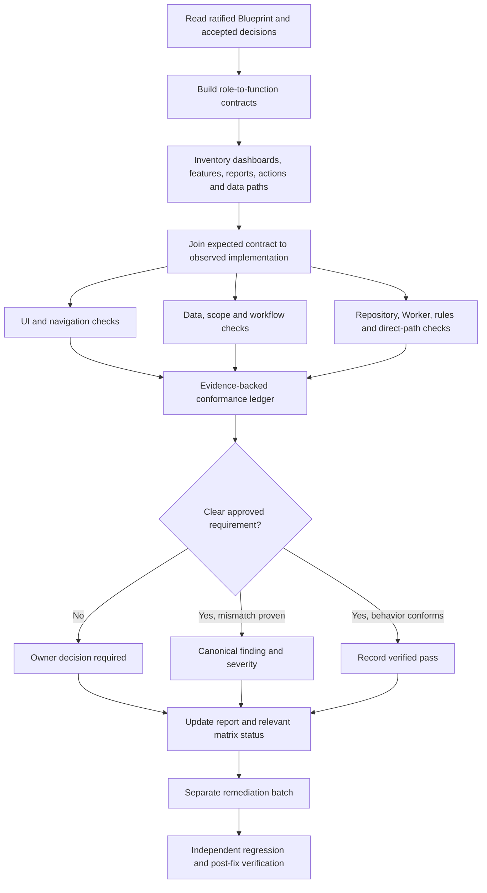

# MyLiberty Portal — Role & Business Logic Conformance Audit (BLRCA)

**Document Type:** Level 2 Audit Campaign Framework (Modular Procedure)  
**Status:** Restructured from the owner-ratified BLRCA procedure dated 2026-10-15; moved content is intended to preserve the approved meaning. Passages marked `[NEW — PENDING OWNER REVIEW]` are additions and are not represented as owner-ratified.  
**Scope:** Cross-cutting, role-by-role and dashboard-by-dashboard governance conformance  
**Canonical Governance Authority:** [`docs/governance/MYLIBERTY-AUTHORITATIVE-BLUEPRINT.md`](../../governance/MYLIBERTY-AUTHORITATIVE-BLUEPRINT.md)  
**Technical Architecture:** [`docs/ARCHITECTURE.md`](../../ARCHITECTURE.md)  
**Host Audit Strategy:** [`docs/audits/Comprehensive Hidden-Bug Audit Strategy/00-README.md`](../Comprehensive%20Hidden-Bug%20Audit%20Strategy/00-README.md)  
**Cross-Cutting Baseline:** [`docs/audits/blueprint-conformance-matrix.md`](../blueprint-conformance-matrix.md)  
**Historical Baseline:** Reviewed against local HEAD `99163ca` (2026-10-15); re-verify against target commit before each campaign slice execution.

---

## 1. Purpose & Central Question

The Business Logic & Role Conformance Audit (BLRCA) detects cases where MyLiberty Portal may be technically functional but misunderstands or misapplies the company's approved organizational structure, job responsibilities, decision rights, data visibility, or workflows.

The central question of BLRCA is:

> **For this specific role, in this specific scope and workflow state, is this capability both permitted and appropriate under the ratified governance baseline—and is that boundary enforced through the complete execution path?**

BLRCA systematically verifies two distinct failure modes:

1. **Excess capability:** A role can see, change, approve, export, or administer something outside its approved business responsibility (e.g., technical System Admin viewing financial tuition figures, or Front Office issuing unauthorized discounts).
2. **Missing or misassigned capability:** A role cannot perform a legitimate business function, or the function has been assigned to the wrong role or scope (e.g., satellite Course Division Managers unable to supervise local shift cash drawers, or Central Instructor Leader blocked from reviewing satellite academic evaluations).

### Technical Correctness vs. Business Correctness

A feature may pass all TypeScript checks, render without React errors, return HTTP 200, and pass unit tests, yet remain **fundamentally non-conformant** if it violates company governance.

- A screen that loads does not prove the role should see it.
- A button that is hidden in the UI does not prove the backend enforces authorization.
- A read-only interface can still violate data privacy and confidentiality.
- Passing security rules tests do not prove that business calculations or maker-checker separations are preserved.
- Code conventions or historical patterns are evidence of what was coded, never authority for what the company should do.

---

## 2. Where BLRCA Fits in the Audit System

BLRCA is a **specialized Level 2 campaign**, not a fourth audit level or an independent source of governance policy.

The repository's modular verification system operates across three levels:

```text
AUTHORITATIVE BLUEPRINT (docs/governance/MYLIBERTY-AUTHORITATIVE-BLUEPRINT.md)
        ↓
    defines WHAT is true (organizational identity, authority boundaries, separation of duties)
        ↓
ACCEPTED OWNER DECISIONS (docs/decisions/)
        ↓
    defines BINDING POLICIES & FORMAL EXCEPTIONS (ratified owner decisions)
        ↓
TECHNICAL ARCHITECTURE (docs/ARCHITECTURE.md)
        ↓
    defines HOW it is implemented (structure, contracts, repositories, rules)
        ↓
VERIFICATION SYSTEM (docs/audits/)
    ├── Level 1: Light Regression Check Playbook (targeted post-change checks)
    ├── Level 2: Comprehensive Hidden-Bug Audit Strategy (detailed functional & workflow QA)
    │     └── BLRCA (Role & Business Logic Conformance Campaign — THIS FRAMEWORK)
    └── Level 3: Full System Architecture & Scalability Audit Procedure
```

BLRCA fulfills the Level 2 mandate—which designates Level 2 as *"the primary audit level for the role-by-role and dashboard-by-dashboard refinement effort"*—by providing a structured, slice-by-slice campaign methodology across roles, scopes, and workflows.

### Relationship to Canonical Registers

BLRCA feeds evidence into existing repository registers and never creates competing registers:

- **[`blueprint-conformance-matrix.md`](../blueprint-conformance-matrix.md):** The single authoritative cross-cutting invariant register. BLRCA supplies verified evidence for invariants (INV-01 through INV-12). Campaign start does not reset existing `COMPLIANT` statuses.
- **[`docs/audits/current/bug-ledger.md`](../current/bug-ledger.md):** The canonical master bug ledger. Every BLRCA mismatch receives a canonical finding ID (e.g., `DOM11-GOV-02`, `DOM01-GOV-03`).
- **[`docs/audits/current/regression-log.md`](../current/regression-log.md):** Records post-remediation verification evidence and targeted regression runs.
- **[`docs/audits/audit-log.md`](../audit-log.md):** Chronological log of operational audit milestones and owner decisions.

Existing domain audits (Domain 1: auth/roles/permissions, Domain 4: payments/cash, Domain 11: reports/dashboards, Domain 12: UX/navigation) provide valuable historical evidence. However, a prior domain marked closed does **not** exempt a role or feature from BLRCA.

---

## 3. Modular File Architecture

This framework is organized into eight numbered procedure files:

| File | Title | Purpose & When to Consult |
|---|---|---|
| **[`00-README.md`](./00-README.md)** | Purpose and Operating Model | This entry point: philosophy, architecture integration, campaign status, and navigation. Consult first before any BLRCA work. |
| **[`01-governance-and-role-contracts.md`](./01-governance-and-role-contracts.md)** | Establishing Approved Role Contracts | How to derive expected contracts from canonical sources; roles vs. technical identities; canonical IDs vs. aliases; tracking open governance decisions. Consult during Phase 1. |
| **[`02-feature-discovery-and-coverage.md`](./02-feature-discovery-and-coverage.md)** | Feature Discovery & Coverage | How to inventory all dashboards, routes, components, actions, queries, Worker endpoints, scripts, and hidden execution paths. Consult during Phase 2. |
| **[`03-technical-audit-method.md`](./03-technical-audit-method.md)** | Technical Audit Method | Actionable end-to-end tracing method; six conformance dimensions; session/cache leakage; "denial-looks-like-zero" fail-closed checks; dated worked example. Consult during Phase 3. |
| **[`04-risk-tiers-and-test-matrix.md`](./04-risk-tiers-and-test-matrix.md)** | Risk Tiers & Test Matrix | Tier 1 (high-risk), Tier 2 (operational), Tier 3 (informational); mandatory test types (positive, negative, boundary, alternate-path); financial decisions integration. Consult when planning checks. |
| **[`05-campaign-execution-and-coverage.md`](./05-campaign-execution-and-coverage.md)** | Campaign Execution & Coverage | Phases 0–6 step-by-step; slice-by-slice execution model; role-function ledger structure; slice dependencies; slice completion criteria. Consult when running a campaign slice. |
| **[`06-findings-and-closure.md`](./06-findings-and-closure.md)** | Findings, Evidence & Closure | Atomic check outcomes (PASS, FAIL, BLOCKED, NOT TESTED, NOT APPLICABLE); categories; severity rationale; register integration; remediation handoff and post-fix verification. Consult when logging results. |
| **[`07-agent-instructions.md`](./07-agent-instructions.md)** | Auditor Operating Contract | Mandatory operating contract for AI coding/auditing assistants: audit-only boundaries, safety rules, stop-and-report protocols, and core auditor mindset. Consult whenever an agent operates on BLRCA. |

---

## 4. Campaign Execution Sequence & Slice-by-Slice Model

To ensure thoroughness without overwhelming the zero-budget environment, BLRCA executes in distinct, independently completable and verifiable **slices**:

1. **Slice 1 — System Admin Boundary:** Technical-only boundary verification across all business and data surfaces. (Status: Audited 2026-10-15; remediated in `220c10a`/`131f1b2`; verified CLOSED on 2026-10-16).
2. **Slice 2 — Financial Surfaces Across Roles:** Comprehensive financial audit across all roles (payments, tuition, receipts, discounts/refunds, cash reconciliation, payment corrections/voids, and financial reports). (Status: Audited 2026-10-16; remediated and verified CLOSED on 2026-10-16; findings `DOM04-GOV-03`..`07` resolved).
3. **Slice 3 — Student, Child & Parent Personal Data:** Personal data exposure, profile access, and family privacy across all roles and linkage paths. (Status: Audited 2026-10-16; remediated and verified CLOSED on 2026-10-16; findings `DOM04-SEC-03`, `DOM05-SEC-02`..`04`, `DOM05-GOV-02`..`03`, `DOM05-PRIV-01`, `DOM05-UX-02`, `DOM11-SEC-01`, `DOM11-GOV-04` resolved; `DOM05-PRIV-02` accepted risk under OD-STU-3 Option A).
4. **Slice 4 — Data Exports, Downloads & Print Operations:** CSV exports, clipboard operations, printed receipts, and reports across all roles. (Status: Audited 2026-10-16; remediated and verified CLOSED on 2026-10-16; findings `DOM04-CSV-01`, `DOM11-PRIV-01`, `DOM11-GOV-05`, `DOM05-UX-03`, `DOM05-PRIV-03`, `DOM06-PRIV-01`, `DOM04-PRIV-01`, `DOM11-TECH-02` resolved under ratified OD-EXP-1 Option A).
5. **Slice 5+ — Remaining Individual Organizational Roles:** Course Division Manager, Kindergarten Division Manager, Operational Leader, Central Instructor Leader, Front Office, Instructors, and Facilities/Staff evaluated one at a time.

---

## 5. Active Campaign State & Evidence Pointers

### Current Campaign Artifact Status

The consolidated BLRCA campaign artifacts are established and actively maintained:

- **Master Campaign Audit Report:** [`docs/audits/current/role-business-logic-conformance-audit.md`](../current/role-business-logic-conformance-audit.md) (Contains Slice 1 verified summary, Slice 2 Financial Surfaces, Slice 3 Personal Data, and Slice 4 Exports & Prints reports).
- **Master Role-Function Ledger:** [`docs/audits/current/role-function-conformance-ledger.md`](../current/role-function-conformance-ledger.md) (Granular testable matrix rows across all roles and evaluated capabilities).

### Verified Campaign Evidence

- **Slice 1 Evidence (System Admin Boundary — CLOSED):**
  - Findings: `DOM11-GOV-02`, `DOM01-GOV-03`, `DOM01-REP-01`, `DOM01-PERF-01` in [`docs/audits/current/bug-ledger.md`](../current/bug-ledger.md).
  - Remediation Plan: [`docs/plans/active/2026-10-15-blrca-slice1-system-admin-remediation.md`](../../plans/active/2026-10-15-blrca-slice1-system-admin-remediation.md) (Completed).
- **Slice 2 Evidence (Financial Surfaces Across Roles — CLOSED):**
  - Findings: `DOM04-GOV-03`, `DOM04-SEC-02`, `DOM04-GOV-04`, `DOM04-GOV-05`, `DOM04-GOV-06`, `DOM04-GOV-07` in [`docs/audits/current/bug-ledger.md`](../current/bug-ledger.md) (All CLOSED).
  - Remediation Plan: [`docs/plans/active/2026-10-16-blrca-slice2-financial-surfaces-remediation.md`](../../plans/active/2026-10-16-blrca-slice2-financial-surfaces-remediation.md) (Completed).
  - Master Report & Ledger: [`role-business-logic-conformance-audit.md`](../current/role-business-logic-conformance-audit.md) §3 and [`role-function-conformance-ledger.md`](../current/role-function-conformance-ledger.md) §3.
- **Slice 3 Evidence (Student, Child & Parent Personal Data — CLOSED):**
  - Findings: `DOM04-SEC-03`, `DOM05-SEC-02`, `DOM05-SEC-03`, `DOM05-SEC-04`, `DOM05-GOV-02`, `DOM05-GOV-03`, `DOM05-PRIV-01`, `DOM05-UX-02`, `DOM11-SEC-01`, `DOM11-GOV-04` (CLOSED), `DOM05-PRIV-02` (ACCEPTED RISK) in [`docs/audits/current/bug-ledger.md`](../current/bug-ledger.md).
  - Remediation Plan: [`docs/plans/active/2026-10-16-blrca-slice3-personal-data-remediation.md`](../../plans/active/2026-10-16-blrca-slice3-personal-data-remediation.md) (Completed).
  - Master Report & Ledger: [`role-business-logic-conformance-audit.md`](../current/role-business-logic-conformance-audit.md) §5 and [`role-function-conformance-ledger.md`](../current/role-function-conformance-ledger.md) §4.
- **Slice 4 Evidence (Data Exports, Downloads & Print Operations — CLOSED):**
  - Findings: `DOM04-CSV-01`, `DOM11-PRIV-01`, `DOM11-GOV-05`, `DOM05-UX-03`, `DOM05-PRIV-03`, `DOM06-PRIV-01`, `DOM04-PRIV-01`, `DOM11-TECH-02` in [`docs/audits/current/bug-ledger.md`](../current/bug-ledger.md) (All CLOSED).
  - Remediation Plan: [`docs/plans/active/2026-10-16-blrca-slice4-exports-and-prints-remediation.md`](../../plans/active/2026-10-16-blrca-slice4-exports-and-prints-remediation.md) (Completed).
  - Master Report & Ledger: [`role-business-logic-conformance-audit.md`](../current/role-business-logic-conformance-audit.md) §7 and [`role-function-conformance-ledger.md`](../current/role-function-conformance-ledger.md) §5.
- **Audit Log:** [`docs/audits/audit-log.md`](../audit-log.md).
- **Regression Log:** [`docs/audits/current/regression-log.md`](../current/regression-log.md).

*Next Step for Campaign:* Proceed to **Slice 5: Division Managers & Functional Leadership Across Campuses**.


---

## 6. Flow Diagram & Core Auditor Rule

### Compact Audit Flow



### Core Auditor Operating Rule

> **Do not ask only: "Can this role access this screen?"**  
> **Ask: "What business responsibility justifies this role seeing or doing this, at this scope and workflow state, and which approved source establishes that responsibility?"**
