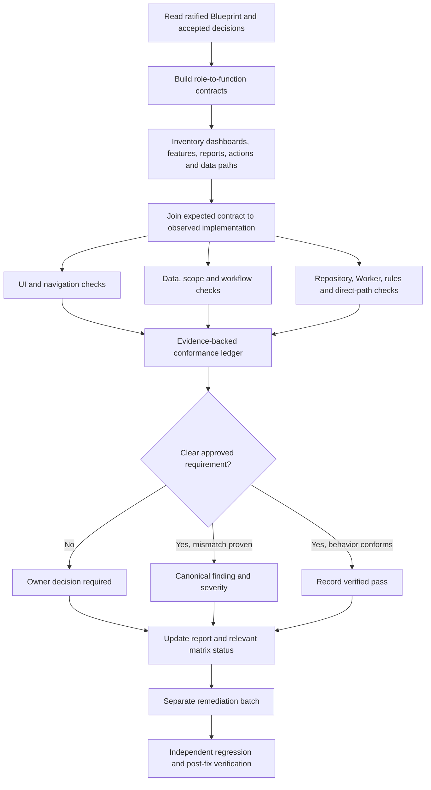

# MyLiberty Portal — Role & Business Logic Conformance Audit (BLRCA)

**Document type:** Level 2 Audit Campaign Procedure  
**Status:** APPROVED AUDIT CAMPAIGN PROCEDURE (Ratified by Owner Kifry, 2026-10-15)  
**Scope:** Cross-cutting, role-by-role and dashboard-by-dashboard governance conformance  
**Repository baseline:** Reviewed against local HEAD 99163ca (2026-10-15); re-verify against the target commit before execution.

---

## 1. Purpose

The Business Logic & Role Conformance Audit (BLRCA) detects cases where MyLiberty Portal may be technically functional but misunderstand the company's approved organizational structure, job responsibilities, decision rights, data visibility, or workflows.

The central question is:

> **For this specific role, in this specific scope and workflow state, is this capability both permitted and appropriate under the ratified governance baseline—and is that boundary enforced through the complete execution path?**

The audit must detect both:

- **Excess capability:** a role can see, change, approve, export, or administer something outside its approved responsibility.
- **Missing or misassigned capability:** a role cannot perform a legitimate function, or the function is assigned to the wrong role.

A screen that loads, a button that is hidden, a read-only interface, passing security tests, or existing code conventions do not independently prove conformance.

## 2. Where it fits in the existing audit system

BLRCA is a **Level 2 campaign**, not a fourth audit level. The Level 2 audit strategy ([`docs/audits/Comprehensive Hidden-Bug Audit Strategy/00-README.md`](../Comprehensive%20Hidden-Bug%20Audit%20Strategy/00-README.md)) already designates Level 2 as *"the primary audit level for the role-by-role and dashboard-by-dashboard refinement effort"*; BLRCA provides the structured campaign methodology for systematically executing that role-by-role and screen-by-screen mandate.

It operates within the established three-level verification hierarchy without creating competing structures:

- **Level 1 — Targeted regression:** preserve role/function boundaries affected by each code change and verify post-remediation fixes.
- **Level 2 — Deep functional and workflow conformance (Campaign Host):** execute the BLRCA campaign passes slice-by-slice across roles, scopes, and workflows.
- **Level 3 — Architecture and scalability:** verify that the same boundaries hold across frontend, repositories, Firestore rules, Cloudflare Worker endpoints, background/automated paths, and direct requests.
- **Blueprint Conformance Matrix:** remain the one cross-cutting invariant/status register. BLRCA supplies evidence and findings to it; it must not create a competing governance authority.
- **`docs/audits/current/bug-ledger.md`:** receive canonical finding IDs and concise entries, following existing conventions.
- **`docs/audits/current/regression-log.md`:** record verification and post-remediation regression evidence.

Existing Domain 1 (auth/roles/permissions), Domain 11 (reports/dashboards), Domain 12 (UX/navigation), and the lifecycle/cross-feature audit are useful evidence sources, but a prior domain marked closed does not exempt a role or feature from BLRCA. Their pass status is not a substitute for checking business meaning.

## 3. Governance hierarchy and guardrails

The audit must follow the existing order of authority:

1. `docs/governance/MYLIBERTY-AUTHORITATIVE-BLUEPRINT.md` — approved organizational truth.
2. Accepted decisions in `docs/decisions/` — detailed ratified rules that supplement the blueprint.
3. `docs/ARCHITECTURE.md` and applicable technical contracts/specifications — approved implementation approach.
4. Actual implementation and tests — evidence of observed behavior, not authority for what the company should do.
5. Audit reports — evidence and recommendations only; never governance authority.

At the beginning of every run, verify the current blueprint version, status, date, and target Git commit. Do not hard-code a version into the procedure as the permanent authority.

If the blueprint and accepted decisions do not answer a material question, classify it **OWNER DECISION REQUIRED**. Do not infer authority from job seniority, a legacy role, a menu, a shared component, technical admin status, or what is easiest to code.

**Audit-only rule:** the auditor gathers evidence and recommends remediation. It does not silently change code, rules, data, roles, policy, or the conformance status to make the system appear compliant. Code remediation starts only under a separate explicit executor instruction.

## 4. Audit model

BLRCA uses three linked inventories:

### A. Role-to-function contract

For every role, derive the expected contract from the blueprint and accepted decisions:

- purpose of the role;
- allowed business functions;
- prohibited or reserved responsibilities;
- required information visibility and the reason it is needed;
- allowed create/read/update/delete/export actions;
- initiation, review, approval, rejection, and execution authority;
- permitted branch/division/record scope;
- workflow-state constraints and separation-of-duties conditions;
- explicitly approved exceptions or delegations;
- source document and section for each rule.

Each contract row must cite its governing source and be tagged **Established**, **Inferred**, **Proposed**, or **Owner Decision Required**. Only an established, approved rule can independently support a conformance failure. Inferences can guide investigation but must be labelled as such.

### B. Feature and access-path inventory

Discover the complete user-facing feature surface, not only the main dashboard component. Include:

- top-level dashboards and route guards;
- navigation links, tabs, cards, quick actions, nested routes, forms, dialogs, and shared components;
- data displayed in summaries, counters, charts, tables, and detail panels;
- CSV/download/export/print functions and clipboard actions;
- create, edit, delete, approve, reject, execute, restore, and administrative actions;
- repositories, hooks, queries, callable functions, Worker endpoints, Firestore rules, and indirect/background execution paths;
- feature flags, fallbacks, legacy compatibility paths, and alternate ways to reach the same data or operation.

For each feature, record the route/component, the role(s) that can reach it, the data/actions involved, and its backend enforcement path.

### C. Role-function conformance ledger

Join the role contract and feature inventory into one testable ledger. Suggested columns:

| Field | Purpose |
|---|---|
| `Contract ID` | Stable identifier for the expected permission/function |
| `Role + scope` | Specific organizational role, branch/division scope, and relevant system-access identity |
| `Expected behavior` | What should happen, supported by a canonical citation |
| `Feature/path` | Dashboard, tab, action, repository, endpoint, query, or rule location |
| `Observed behavior` | What the implementation actually does |
| `Evidence` | File/line, test command and result, screenshot or reproducible steps as appropriate |
| `Check result` | PASS, FAIL, BLOCKED, NOT TESTED, or NOT APPLICABLE |
| `Mismatch type` | Excess capability, missing capability, wrong role, wrong scope, workflow mismatch, disclosure, or unclear policy |
| `Finding ID` | Link to the canonical bug-ledger entry, where applicable |

Use a row per meaningful role-capability-scope combination. Do not use one broad row such as “Admin is secure” to stand in for reports, exports, user provisioning, audit logs, technical maintenance, and all underlying requests.

## 5. Six conformance dimensions

Every discovered role-feature combination should be assessed against the dimensions that apply to it.

1. **Role and responsibility:** Does this function belong to this role under the approved operating model?
2. **Information visibility:** Is the information necessary and permitted for this role? Treat viewing, summaries, search results, downloads, exports, and detail views as distinct exposure paths where applicable.
   - *Session & cache leakage:* Check module-level or browser-persisted caches, local storage, and service-worker caches for sensitive data surviving sign-out or a user switch on a shared workstation (such as front-desk PCs). Any cache keyed without user identity is a finding candidate. *Concrete example:* `src/features/reports/tabs/FinancialReportsTab.jsx` line ~18 defines `financialCache` as an in-memory module-level `Map` keyed solely by branch, division, and date range with a 5-minute TTL—leaving loaded financial figures in memory across user sessions on shared hardware.
3. **Action and decision authority:** Can the role initiate, modify, delete, approve, reject, or execute only the operations assigned to it? Is a UI control accidentally being treated as the authority source?
4. **Organizational scope:** Are branch, division, executive, student, employee, or other record boundaries correct? Does a valid role accidentally receive a broader scope than intended?
5. **Workflow and separation of duties:** Are workflow states, maker/checker identity, self-approval prevention, required approval order, and post-approval immutability preserved?
6. **Interface-to-enforcement consistency:** Does the UI communicate the right role behavior, and do data repositories, Worker endpoints, Firestore rules, and direct requests enforce the same boundary?
   - *Denial-looks-like-zero (Fail-closed presentation):* A permission-denied or failed query must never be presented to the user as a legitimate empty result or zero business figure (such as "Rp 0" revenue or 0 active students). *Concrete example:* `FinancialReportsTab.jsx` catches data loading errors with `console.error` only, allowing the UI to render empty/zero totals instead of an explicit error state. Cross-reference Level 2's core concern regarding "false zero figures" arising from index degradation or unhandled errors (`docs/audits/Comprehensive Hidden-Bug Audit Strategy/00-README.md`).

A particular feature need not involve all six dimensions, but the auditor must record why a dimension is not applicable rather than skipping it silently.

## 6. Execution workflow

### Risk tiers and execution slices

To keep the audit structured, thorough, and tractable on a zero-budget setup, role-feature combinations are partitioned into three risk tiers, and execution proceeds slice-by-slice:

#### Risk Tiers
- **Tier 1 (Critical / High-Risk Surfaces — All 4 check types mandatory: positive, negative, boundary, alternate-path):**
  Money / payments / tuition / discounts / refunds, student / child / parent personal data, staff access and role changes, exports / downloads, approvals / maker-checker workflows, audit logs, deletions, and payroll-affecting attendance records.
- **Tier 2 (Operational Surfaces — 3 check types mandatory: positive, negative, boundary):**
  Other operational writes, cohort scheduling, facility tasks, shift logging, and branch/division-scoped operational views.
- **Tier 3 (Informational & Presentation Surfaces — Positive and negative checks; UI-level evidence acceptable):**
  Navigation menus, labels, badges, and low-impact read-only views.

#### Slice-by-Slice Execution Order
Execution is organized into distinct slices. Each slice is independently completable, verifiable, and reportable:
1. **Slice 1:** System Admin (`admin`) across all data and business surfaces (verifying strict adherence to technical-only boundaries).
2. **Slice 2:** Financial surfaces across all roles (payments, tuition, receipts, discounts, cash reconciliation, financial reports). Evaluates compliance with the ratified Multi-Role Financial Data & Operations Model per OD-2 ([`docs/decisions/2026-10-13-payment-correction-payment-data-access-and-cash-discrepancy.md`](../../decisions/2026-10-13-payment-correction-payment-data-access-and-cash-discrepancy.md)), OD-4, and Blueprint §7, §18:
   - *Director (Strategic Control):* Read-only province-wide financial visibility across all branches and divisions for strategic evaluation; approves discounts/refunds and payment corrections/voids (OD-1); approves cash discrepancies ≥ Rp 50.000 (Vice Director acts only as Acting Director during Director's approved leave — OD-4); zero desk cashier write authority (maker-checker separation).
   - *Vice Director (Operational Control):* Read-only province-wide financial visibility across all branches and divisions for operational oversight; approves discounts/refunds and payment corrections/voids (OD-1); approves cash discrepancies Rp 20.000 – Rp 49.999 (OD-4); zero desk cashier write authority.
   - *Course Division Manager:* Read-only financial visibility strictly scoped to Course Division at own assigned branch (`manager + branchId + courses`); at lean satellite branches, approves on-site daily shift cash discrepancies < Rp 20.000 (OD-4); zero discount/void approval authority; zero desk cashier write authority; no visibility into kindergarten tuition.
   - *Kindergarten Division Manager:* Read-only financial visibility strictly scoped to Kindergarten at Main Campus (`kota_gorontalo`); zero course division or satellite branch visibility; zero discount/void approval authority; zero desk cashier write authority.
   - *Operational Leader (`ops_lead`):* Shift coordination and cash drawer balancing oversight for Main Campus; may record payments as a Front Office-class maker (OD-2); approves Main Campus cash discrepancies < Rp 20.000 (OD-4); zero province-wide financial report scope; zero discount/void approval authority.
   - *Front Office Roles (`frontoffice`, `opslead`/`ops_lead`, `frontofficelead` — rules `isFrontOffice()`):* Desk cashier and collection authority for own branch and division; payment makers per OD-2; create payments, issue receipts, record agreed standard installments, submit discount/refund envelopes (`DISCOUNT_OR_REFUND` maker), and reconcile daily shift cash drawers; transactional read access restricted to own branch/division desk payments; zero province-wide financial reporting scope.
   - *System Admin (`admin`):* Strictly forbidden from all financial visibility (reports, counters, queries) and all financial operations (creating, editing, approving). Technical infrastructure authority only per OD-2.
3. **Slice 3:** Student, child, and parent personal data surfaces across all roles.
4. **Slice 4:** Data exports, downloads, and print operations across all roles.
5. **Slice 5+:** Remaining individual organizational roles, evaluated one at a time.

---

### Phase 0 — Establish a reliable baseline

- Record repository, branch, exact commit SHA, date, and verification baseline.
- Read the current authoritative blueprint, all potentially relevant accepted decisions, technical architecture, authorization contract/specs, current audit README, matrix, and relevant closed-domain evidence.
- Check whether the blueprint/decision status has changed since the previous audit.
- Define the audit boundary and clearly list anything not inspected.
- **Baseline handling of matrix statuses:** Existing `COMPLIANT` statuses in `docs/audits/blueprint-conformance-matrix.md` are **not** reset at campaign start. An invariant is flagged for re-verification when concrete contrary evidence exists; its recorded status changes only after the evidence standard in Section 7 is met and the change is formally recorded per Phase 4.

### Phase 1 — Build the expected role contracts

- Enumerate ratified roles, system-access identities, branch/division scopes, authority boundaries, and explicit exceptions. The starting role and identity list to verify against the Blueprint and codebase (as a working baseline, not an unverified authority) includes:
  - `director` (Strategic Control, province-wide executive authority)
  - `vice_director` (Operational Control, operational coordination & delegated executive authority)
  - `admin` (System Admin — technical access only, no business authority)
  - `manager` + `courses` (Course Division Manager — Main Campus and Lean Satellite branches)
  - `manager` + `kindergarten` (Kindergarten Division Manager — Main Campus)
  - `opslead` / Operational Leader (Main Campus operational support)
  - `instructorleader` / Instructor Leader (Central Academic Lead, province-wide pedagogical scope)
  - `frontoffice` / `frontofficelead` (Front Office & Front Office Lead — course and kindergarten customer-facing intake & cashiering)
  - `marketing` (Marketing & communications identity)
  - `instructor` / `staff` / `officeboy` (Teaching and operational support staff)
  - `student` (Learner identity)
  - `parent` (Parent/guardian portal identity)
  - Kiosk / terminal identities (clock-in/clock-out devices)
  - **Non-human identities:** Cloudflare Worker (`cloudflare-worker/worker.js`), service-account / Apps Script integrations (e.g. `FormSync.gs`), and administrative maintenance scripts under `scripts/`. *Critical note:* Service-account and script execution paths bypass Firestore Security Rules entirely and must be audited directly at their own input validation and authorization layer.
- Derive allowed, prohibited, and conditional behaviors from governing sources.
- Identify unresolved rules and log them as owner decisions; do not fabricate a test expectation.
- Owner/advisor review the contract before it is used to judge ambiguous capabilities.

### Phase 2 — Discover the implemented surface

- Build a dashboard/feature inventory from routes and component composition.
- Follow shared components and generic props such as `isAdmin`, `isAdminView`, `canEdit`, role strings, or permission helpers to their actual semantic effects.
- Search for finance, student/parent data, staff access, exports, cross-branch queries, approvals, and other high-risk surfaces.
- Trace data and mutations to their repositories, endpoints, rules, and direct-access boundary.
- Record dead ends, uninspected paths, and code that cannot be conclusively tied to a role.

### Phase 3 — Compare expected and observed behavior

For each role-function row, run four kinds of check where applicable:

- **Positive test:** a permitted role can complete the authorized function.
- **Negative test:** a role that must not have the capability cannot reach or perform it.
- **Boundary test:** a role with valid access is denied access outside its branch/division, workflow state, or delegated scope.
- **Alternate-path test:** direct route, reused component, direct repository/API/Worker call, export, and other bypass paths do not defeat the boundary.

A visible feature is not automatically a backend vulnerability, and a hidden feature is not proof of authorization. Record UI exposure separately from confirmed backend/data/action access.

### Phase 4 — Reconcile findings and matrix status

- Give every mismatch one canonical finding ID.
- Deduplicate repeated symptoms that share the same root cause, while listing all affected roles and entry paths.
- Classify severity from actual impact and record the reasoning.
- Link each finding to the governing invariant(s), source citations, affected code, and evidence.
- Reassess an invariant's overall status only after required UI, data, action, scope, and backend checks are complete.
- If evidence is incomplete, use PARTIALLY RECONCILED or the repository's appropriate status; never preserve COMPLIANT merely because one narrow test passed.

### Phase 5 — Owner decision and remediation handoff

- Present policy ambiguities to the owner separately from confirmed implementation defects.
- Prepare a bounded remediation ticket or executor prompt for each accepted fix batch.
- Specify regression tests for affected and neighboring roles so a correction does not overcorrect by removing legitimate access.
- Keep the audit agent read-only unless the owner explicitly commissions implementation work.

### Phase 6 — Independent post-fix verification

- Re-run the original failing cases and their negative/boundary/alternate-path cases.
- Confirm that the expected role still has necessary permitted functionality.
- Confirm that the new behavior is enforced below the UI wherever applicable.
- Update the ledger, bug ledger, regression log, and Blueprint Conformance Matrix with evidence and the new commit reference.

## 7. Evidence and result rules

### Atomic check outcomes

- **PASS:** expected behavior and relevant enforcement were verified with reproducible evidence.
- **FAIL:** observed behavior conflicts with an established requirement.
- **BLOCKED:** verification could not safely or reliably be completed; state the blocker.
- **NOT TESTED:** no evidence has yet been collected.
- **NOT APPLICABLE:** the dimension truly does not apply, with a brief reason.

These atomic results complement the existing overall matrix statuses; they do not replace or conflict with the matrix's established `COMPLIANT`, `PARTIALLY RECONCILED`, `DIVERGENT`, and `DECISION REQUIRED` status scale.

### Finding categories

Use the existing advisor rules: Bug, Security Vulnerability, Governance Conflict, Governance Gap, Technical Debt, or Improvement. A row may be a conformance failure without being a security vulnerability; use the correct category.

Suggested severity interpretation:

- **CRITICAL:** credible unauthorized access to highly sensitive data or high-impact business action, serious approval bypass, or comparable immediate risk.
- **HIGH:** substantial unauthorized capability, material data-scope breach, wrong approval authority, or repeated role-boundary failure.
- **MEDIUM:** material workflow misassignment, legitimate capability incorrectly withheld, or misleading business behavior likely to cause operational mistakes.
- **LOW:** role terminology or navigation mismatch with limited direct impact.
- **INFO:** observation or hardening opportunity without a confirmed requirement violation.

Severity must be justified by impact and evidence, not the number of lines changed or the visual prominence of the feature.

### Evidence quality

Separate statements into **Established**, **Observed**, **Inferred**, **Proposed**, and **Owner Decision Required**, as the existing advisor rules require.

A source-code inspection can prove what code is written and that a component is configured to expose a view. It may not prove that data retrieval succeeds under all deployed rules. Use emulator/integration/browser tests or a carefully documented reproduction for behavior claims. Never describe an unrun test as passed.

## 8. Worked example: System Admin and Financial & Tuition reports

This example illustrates the audit method with evidence (**Observed by source inspection — not yet emulator-verified** at local HEAD `99163ca`, 2026-10-15):

- **Expected contract (Ratified Policy per OD-2 [`docs/decisions/2026-10-13-payment-correction-payment-data-access-and-cash-discrepancy.md`](../../decisions/2026-10-13-payment-correction-payment-data-access-and-cash-discrepancy.md)):**
  - *System Admin (`admin`):* Established by OD-2 (§OD-2: System Admin Read Payments ❌ Forbidden, pending Phase 2 cleanup — cleanup was never tracked): System Admin is strictly forbidden from any visibility into business financial, tuition, and revenue data or reports. System Admin is a technical infrastructure role; technical access must never confer business intelligence, revenue visibility, or financial oversight rights.
  - *Elaborated Multi-Role Financial Governance Contract (OD-2, OD-4, Blueprint §7, §18):*
    1. **Director & Vice Director:** Executive dual-control grants province-wide, cross-division read visibility for strategic and operational performance assessment. Neither executive may act as desk cashier (preserving maker-checker separation). Director approves cash discrepancies ≥ Rp 50.000 (Vice Director acts only as Acting Director during Director's approved leave — OD-4).
    2. **Division Managers (Course & Kindergarten):** Granted read-only financial visibility strictly bounded to their assigned branch and division (`manager + branchId + division`). A Course Manager sees only course revenue at their branch; Kindergarten Manager sees only main campus kindergarten revenue. No cross-branch or cross-division leakage. At lean satellites, Course Division Managers review cash discrepancies < Rp 20.000 (OD-4).
    3. **Operational Leader (`ops_lead`):** Oversees daily desk operations and shift sign-offs for Main Campus; may record payments as a Front Office-class maker (OD-2); approves Main Campus cash discrepancies < Rp 20.000 (OD-4); holds no province-wide financial reporting rights.
    4. **Front Office Roles (`frontoffice`, `opslead`/`ops_lead`, `frontofficelead` — rules `isFrontOffice()`):** Operational payment makers per OD-2 for payment collection, receipt issuance, and shift drawer balancing for own branch and division. Hold transactional read access to their branch's desk payments, but no province-wide financial reporting scope.
    5. **System Admin (`admin`):** Strictly zero visibility (reports, document queries, metrics) and zero write authority per OD-2.
- **Observed static paths at HEAD 99163ca:**
  - *UI exposure:* `src/features/dashboard/AdminDashboard.jsx:274` mounts `<ReportsDashboard isAdminView={true} ... canEdit={false} />`.
  - *Tab & filter elevation:* `src/features/reports/ReportsDashboard.jsx:24-27` derives `isActualAdmin`, which grants access to the Financial & Tuition tab (line 266) and grants the province-wide "All Campuses" scope filter (`canAccessProvinceScope`).
  - *Data query path:* `src/features/reports/tabs/FinancialReportsTab.jsx:52` calls `fetchPaymentsForWindow` (`src/features/finance/paymentsRepository.js:114`), which lists up to 2,000 `payments` documents across all branches.
  - *Backend rules permission:* In `firestore.rules`, the rule for `match /payments/{paymentId}` specifies `allow list: if isExecutive() || ...`. The rule helper `isExecutive()` is defined as `isDirector() || isViceDirector() || isAdmin()`. Thus, the backend security rule as written appears to permit System Admin to list all payment documents province-wide—indicating that this is not merely an isolated UI exposure, but potentially an end-to-end data exposure.
  - *Scale note across rules:* `isExecutive()` (which includes `isAdmin()`) appears 46 times across `firestore.rules`, whereas `isOrgExecutive()` (Director and Vice Director only) appears only 7 times. Consequently, **Slice 1 (System Admin)** must review every single occurrence of `isExecutive()` to ensure technical Admin does not retain unauthorized business data visibility or operational authority.
  - *Related cache & error observations:*
    - In `FinancialReportsTab.jsx:18`, `financialCache` is a module-level `Map` keyed only by branch/division/range (5-minute TTL) and not keyed by user identity, risking shared-device cache leakage across sessions.
    - In `FinancialReportsTab.jsx:52`, query failures are caught with `console.error` only, risking that permission-denied queries render as "Rp 0" (denial-looks-like-zero).
- **Governance status:** Confirmed Governance Conflict per OD-2 (`docs/decisions/2026-10-13-payment-correction-payment-data-access-and-cash-discrepancy.md`). The policy requirement is authoritative: System Admin must have zero financial visibility. The remaining engineering step is verifying runtime behavior in the emulator and preparing bounded remediation.
- **Status before backend tests:** Recorded as **Observed by source inspection — not yet emulator-verified**. Backend access appears permitted by the rule text, but confirmation requires a running emulator test.
- **Required next evidence:** An emulator test asserting whether a caller authenticated with the `admin` role can successfully list documents from `/payments`.
- **Likely remediation direction:** Disentangle `isAdmin()` from `isExecutive()` where business data is concerned (e.g. migrate financial reads to `isOrgExecutive()`); remove the Financial tab from `AdminDashboard`; enforce role-appropriate scoping for Division Managers, Front Office, and Executives at both repository and rules layers; and add automated positive and negative emulator tests. The auditor recommends this direction but does not implement code changes during audit-only work.

## 9. Required deliverables

Keep the initial deliverables small and integrated with the existing repository.

1. **Audit design/procedure:** this document, after owner review, to be placed under a clearly named permanent audit-procedure folder.
2. **Role-to-function contract and conformance ledger:** the single working inventory used during the campaign, with governing-source citations and evidence links.
3. **Current audit report:** a concise executive verdict, scope and commit, verified findings, unverified hypotheses, owner decisions, severity, and prioritized next actions.
4. **Existing registers updated:** canonical finding IDs in `bug-ledger.md`, verification evidence in `regression-log.md`, and justified invariant status changes in `blueprint-conformance-matrix.md`.
5. **Remediation and re-test checklist:** linked to finding IDs so no issue disappears between audit and implementation.

Suggested locations, subject to existing folder conventions:

- Level 2 campaign procedure: `docs/audits/Role & Business Logic Conformance Audit/` (this document, `MyLiberty-Role-Business-Logic-Conformance-Audit-Design.md`, maintained in this directory as the Level 2 campaign procedure; or `00-README.md` if expanded into modular files).
- Active campaign result: `docs/audits/current/role-business-logic-conformance-audit.md`.
- Working campaign ledger: `docs/audits/current/role-function-conformance-ledger.md`.

Do not add a new parallel status registry or re-document full existing domain findings. Link to the existing domain audit and finding IDs instead.

## 10. Completion criteria

The campaign is executed and may be closed **slice-by-slice**, allowing individual slices (e.g. Slice 1: System Admin, Slice 2: Financial surfaces) to be completed, verified, and reported independently without waiting for the entire application surface to be audited.

A campaign slice is complete when:

- every role relevant to the slice has been mapped to an evidence-backed role contract, or an explicit exception is logged;
- every dashboard and meaningful nested feature/action/data view in the slice has been inventoried or explicitly declared out of scope;
- Tier 1 and Tier 2 role-function combinations in the slice have completed all required check types (all 4 check types for Tier 1; 3 check types for Tier 2); Tier 3 items (navigation, labels, low-impact views) may be declared out of scope with a recorded reason instead of blocking completion;
- material data and action paths within the slice have been traced beyond the UI into repositories, Worker endpoints, and Firestore security rules;
- each finding has a canonical ID in `bug-ledger.md`, source requirement, evidence, impact, owner-decision flag, and remediation priority;
- every invariant status changed by the slice has evidence adequate for that status;
- unknown policy questions are separated from confirmed code defects;
- an independent reviewer can reproduce the major findings from the report;
- the owner receives a plain-language summary of what is wrong, why it matters, what must be decided, and what should be fixed first.

The goal is not to force every feature into a simplistic role matrix. The goal is to make every important role-function decision explainable, traceable to approved governance, and testable against the real application.

---

## Appendix A — Compact audit flow

## Appendix B — Auditor operating rule

**Do not ask only “Can this role access this screen?” Ask “What business responsibility justifies this role seeing or doing this, at this scope and workflow state, and which approved source establishes that responsibility?”**
