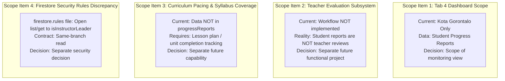
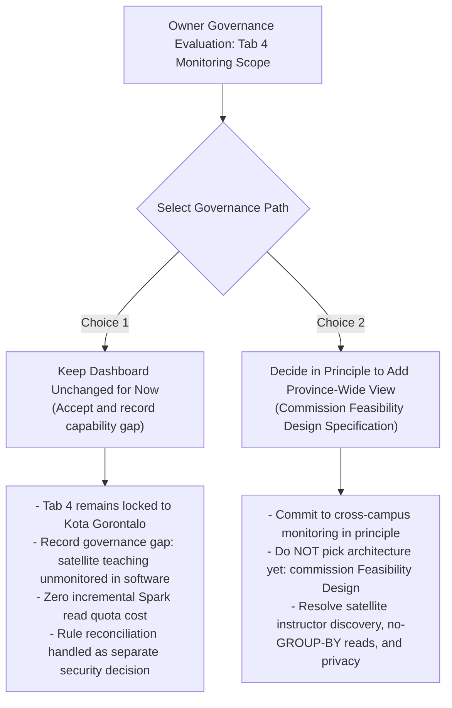

# Owner Decision Brief: Tab 4 Academic Progress & Province-Wide Academic Monitoring Scope

**Document Path:** `docs/proposals/2026-10-18-instructor-leader-province-wide-academic-monitoring-scope.md`  
**Date:** 2026-10-18 (Revised Draft v8)  
**Status:** **PARTIALLY APPROVED — FEASIBILITY DESIGN AUTHORIZED; CROSS-BRANCH IMPLEMENTATION NOT AUTHORIZED**  
**Category:** Governance, Data Protection, System Specification & Architectural Evaluation  
**Target Role:** Instructor Leader / Central Academic Lead (`instructorleader`, `instructor_leader`)  
**Target Workspace:** `src/features/dashboard/InstructorLeaderDashboard.jsx` (specifically Tab 4: `AcademicProgressLeader.jsx`)  
**Governing Authority:** Authoritative Blueprint v3.4.1 (§4, §5, §6.11, §15, §16, §19, §26 G-003, G-007, G-011, G-012, §41); Accepted Decisions G-001–G-012 (2026-10-07, 2026-10-13); Decision `OD-OPS-01` (2026-10-17)  
**Related Audit Findings:** `DOM07-GOV-04` (Province-wide academic approvals), `DOM09-GOV-06` (Central Lead multi-branch switcher gap), `FP-IL-15` (Reports tab role fit), `FP-IL-17` (Learner Progress error handling)  

---

## Owner Approval Addendum (2026-10-18)

Owner Kifry approved the following decisions in the conversation on 2026-10-18; this addendum supersedes the earlier “awaiting owner approval” status and open-choice wording below:

- **Q1 / Q2:** Authorize a dedicated feasibility design for province-wide academic monitoring. Keep Tab 4 unchanged and home-campus scoped during that work. No feature implementation or expanded query is approved yet.
- **Q3 / Option 3A:** Keep raw Instructor Leader `/progressReports` access branch-scoped, with a strict branch constraint for list queries. The binding record is [`docs/decisions/2026-10-18-instructor-leader-academic-monitoring-scope.md`](../decisions/2026-10-18-instructor-leader-academic-monitoring-scope.md).
- **Q4:** Keep teacher evaluation as a separate future workflow.

The local repository rules and regression tests are being aligned to this decision. The live Firebase ruleset has not been inspected; no deployment is authorized by this approval.

---

## Strict Noncanonical Proposal Notice

> [!IMPORTANT]
> **Noncanonical analysis notice:** This document remains a decision analysis and feasibility proposal. The owner-approved direction is recorded in the addendum above and the canonical decision record under `docs/decisions/`. This document does not supersede the Blueprint or authorize implementation of province-wide monitoring or deployment.

---

## 1. Scope of Review & Evidence Map

In accordance with the **Decision Brief Quality Gate** in [`AGENTS.md`](file:///e:/myliberty-portal/AGENTS.md) and [`docs/proposals/README.md`](file:///e:/myliberty-portal/docs/proposals/README.md), all claims in this brief are categorized and mapped directly to verified repository artifacts.

### 1.1 Verified Repository Files and Sections Inspected

| Source Type | File Path | Sections / Lines Inspected | Subject Matter Verified |
|---|---|---|---|
| **Authoritative Governance** | [`docs/governance/MYLIBERTY-AUTHORITATIVE-BLUEPRINT.md`](file:///e:/myliberty-portal/docs/governance/MYLIBERTY-AUTHORITATIVE-BLUEPRINT.md) | §4, §5, §6.11 (lines 701–720), §15 (line 1065), §16 (line 1111), §19 (lines 1199–1217), §20 (lines 1219–1230), §26 (G-003, G-007, G-011, G-012), §41 | Central Academic Lead duties, reporting lines, data-scope boundaries, child data privacy, branch typology. |
| **Accepted Owner Decisions** | [`docs/decisions/2026-10-17-operational-leader-progress-reports-read-access-main-campus.md`](file:///e:/myliberty-portal/docs/decisions/2026-10-17-operational-leader-progress-reports-read-access-main-campus.md) | Full document (`OD-OPS-01`) | Precedent on Firestore document-level data exposure and owner acceptance of full-payload reads. |
| **Accepted Owner Decisions** | [`docs/decisions/2026-10-13-branch-typology-and-lean-branch-governance-amendment.md`](file:///e:/myliberty-portal/docs/decisions/2026-10-13-branch-typology-and-lean-branch-governance-amendment.md) | Full document (G-012) | Main campus vs lean satellite branch operational structures and province-wide academic scope. |
| **Accepted Owner Decisions** | [`docs/decisions/2026-09-24-multi-branch-data-isolation.md`](file:///e:/myliberty-portal/docs/decisions/2026-09-24-multi-branch-data-isolation.md) | Full document | Multi-branch data isolation baseline. |
| **Subsystem Specifications** | [`docs/specs/authorization-contract.md`](file:///e:/myliberty-portal/docs/specs/authorization-contract.md) | §6.6 (lines 151–165), §6.7 (lines 166–178) | Progress reports read authority specification (`Same branch`) vs Central Academic Lead multi-branch scope. |
| **Database Security Rules** | [`firestore.rules`](file:///e:/myliberty-portal/firestore.rules) | Lines 114–120 (`isInstructorLeader`), lines 859 (`users`), lines 977 (`classes`), 1018 (`attendance`), 1111–1112 (`classAttendance`), 1313–1360 (`progressReports`) | At proposal time, the `/progressReports` Instructor Leader clauses were unbounded; the approved source change is branch-scoped. Deployed rules remain unverified. |
| **Database Indexes** | [`firestore.indexes.json`](file:///e:/myliberty-portal/firestore.indexes.json) | Lines 45–68 (`progressReports` indexes) | Verified composite indexes for `branchId + examDate` and `branchId + division + examDate`. No province-wide index. |
| **UI Implementation (Tab 4)** | [`src/features/dashboard/InstructorLeaderDashboard.jsx`](file:///e:/myliberty-portal/src/features/dashboard/InstructorLeaderDashboard.jsx) | Lines 161–168 | Mounts Tab 4 (`AcademicProgressLeader`). |
| **UI Implementation (Tab 4)** | [`src/features/dashboard/instructor/leader/AcademicProgressLeader.jsx`](file:///e:/myliberty-portal/src/features/dashboard/instructor/leader/AcademicProgressLeader.jsx) | Full component (lines 1–223) | Home-branch progress monitoring, 40-record limit, instructor recency tracking, and documented missing teacher evaluation subsystem (lines 201–218). |
| **UI State Hook** | [`src/features/dashboard/instructor/useInstructorLeaderWorkspace.js`](file:///e:/myliberty-portal/src/features/dashboard/instructor/useInstructorLeaderWorkspace.js) | Lines 83–111 | Workspace hook subscribing to home-branch progress reports via `effectiveBranch`. |
| **Data Repository** | [`src/features/dashboard/instructor/instructorLeaderRepository.js`](file:///e:/myliberty-portal/src/features/dashboard/instructor/instructorLeaderRepository.js) | Lines 82–101 | `listenToBranchProgressReports` enforces `where("branchId", "==", branchId)`, `orderBy("examDate", "desc")`, `limit(100)`. |
| **Automated Tests** | [`src/features/dashboard/instructor/instructorLeaderRepository.test.js`](file:///e:/myliberty-portal/src/features/dashboard/instructor/instructorLeaderRepository.test.js) | Lines 70–93 | Tests asserting that queries filter strictly by `branchId == "kota_gorontalo"` and never return another branch's report. |
| **Data Capture Form** | [`src/features/students/StudentProgressForm.jsx`](file:///e:/myliberty-portal/src/features/students/StudentProgressForm.jsx) | Lines 102–123 | Data schema captured upon progress report creation: scores, studentId, classId, instructorId, examDate, level, branchId, division, notes. |
| **UI Implementation (Tab 9)** | [`src/features/reports/ReportsDashboard.jsx`](file:///e:/myliberty-portal/src/features/reports/ReportsDashboard.jsx) | Lines 26, 30, 235–239 | Verified that Instructor Leader view is locked to home campus (`canAccessProvinceScope = isExecutiveView`). |

### 1.2 Categorization of Claims

* **Established Policy (Canonical Documents):**
  * Blueprint §6.11: The Instructor Leader is the Central Academic Lead based at Kota Gorontalo with province-wide academic responsibilities (curriculum standardization, pedagogical quality control across all physical branches, teacher schedule assignments, teacher performance evaluations, placement overrides, and substitute teacher approvals). All branch Instructors report directly to the Central Instructor Leader.
  * Blueprint §19: Parent and Child Data Privacy Principle—the organization must minimize unnecessary exposure of child personal information, parent contact details, and academic/progress information.
  * Blueprint §4, §5, G-012: Branch Typology Model establishes Kota Gorontalo as Type 1 (dual-division) and satellite branches as Type 2 (lean single-division Course Academy).
* **Accepted Owner Decisions (Binding Policies):**
  * `OD-OPS-01` (2026-10-17): Read-only progress report visibility granted to Main Campus Operational Leader. Owner Kifry reviewed and accepted the Firestore architectural reality that granting read access exposes full documents (scores, student names, teacher narrative comments) in memory.
  * Decision 2026-10-13: Placement test overrides and substitute teacher requests from all branches route to the Central Instructor Leader.
  * Decision 2026-09-24: Multi-Branch Data Isolation baseline.
* **Subsystem Specification Contract:**
  * [`docs/specs/authorization-contract.md`](file:///e:/myliberty-portal/docs/specs/authorization-contract.md) §6.6: Records the approved read boundary for `progressReports` as `Same branch (isSameBranch / isSameBranchStrict). No division filter.`
* **Observed Implementation (Current Codebase):**
  * **Tab 4 Dashboard:** Subscribes strictly to `effectiveBranch` (`kota_gorontalo`). Displays up to 40 recent evaluations. Suppresses narrative remarks from visual rendering. Explicitly notes in lines 201–218 that teacher evaluations are not implemented in software and progress report submission recency is only an activity proxy.
  * **Prior Repository Rule Divergence (corrected in this change):** The previous repository `firestore.rules` clauses allowed Instructor Leaders to read raw progress reports without branch constraints, contradicting authorization-contract.md §6.6. The local rule source and matching regression tests are now being aligned to same-branch reads. This repository state does not establish what rules are live in Firebase; live deployment state remains unverified.
  * **Satellite Isolation on Supporting Collections:** `/users` ([`firestore.rules:859`](file:///e:/myliberty-portal/firestore.rules#L859)) and `/classes` ([`firestore.rules:977`](file:///e:/myliberty-portal/firestore.rules#L977)) strictly enforce `isSameBranchStrict`. The Instructor Leader at Kota Gorontalo cannot query staff profiles or class rosters from satellite branches.
* **Inferences (Not Binding):**
  * Whether central curriculum quality control genuinely requires reviewing raw report cards or whether aggregate distributions are sufficient.
  * Whether the lack of software visibility into satellite branches impairs educational outcomes in practice.
* **Owner Decisions Required (Open Governance Choices):**
  * Decision Q1: Dashboard Scope & Capability Gap Disposition (Keep dashboard unchanged and record gap vs Decide in principle to add province-wide academic monitoring).
  * Decision Q2: Commission a Separate Feasibility Design before selecting an architecture (if Choice 2 is chosen).
  * Decision Q3: Reconciling the Firestore Security Rule Discrepancy (Separate security decision: Reconcile to same-branch vs Ratify province-wide aggregation scope).
  * Decision Q4: Dedicated Teacher Evaluation Subsystem (Separate functional initiative).

---

## 2. Answering the Owner's Actual Question: Sufficiency & Capability Gap Analysis

> **Owner's Question:** Is the current Tab 4 home-campus monitoring, together with the province-wide academic approval inbox, demonstrably sufficient for the Instructor Leader’s province-wide duties—including curriculum quality and teacher evaluations?

### 2.1 The Blueprint Mandate (Blueprint §6.11)
Blueprint §6.11 establishes four distinct responsibilities for the Central Academic Lead across all physical branches:
1. **Province-wide curriculum standardization and pedagogical quality control** across all branches.
2. **Teacher schedule assignments and coverage coordination**.
3. **Teacher performance evaluations** across all branches ("All branch Instructors report directly to the Central Instructor Leader").
4. **Academic placement overrides (`PLACEMENT_LEVEL_OVERRIDE`) and substitute instructor approvals (`SUBSTITUTE_INSTRUCTOR`)** across all branches.

### 2.2 What the Current Software Tools Deliver

1. **Tab 4 ([`AcademicProgressLeader.jsx`](file:///e:/myliberty-portal/src/features/dashboard/instructor/leader/AcademicProgressLeader.jsx)) has zero satellite visibility:**  
   Tab 4 subscribes strictly to `effectiveBranch` (`kota_gorontalo`). Satellite instructors teaching at Bone Bolango, Limboto, and Pohuwato **do not appear anywhere in Tab 4**. Their report recency is not tracked, their classes are not listed, and their student evaluations are completely absent from the UI.
2. **The Approval Inbox ([`ApprovalInbox.jsx`](file:///e:/myliberty-portal/src/features/shared/ApprovalInbox.jsx)) covers only narrow transactional exceptions:**  
   The inbox processes only `PLACEMENT_LEVEL_OVERRIDE` and `SUBSTITUTE_INSTRUCTOR`. It receives **zero** routine progress reports, **zero** syllabus pacing indicators, **zero** lesson delivery observations, and **zero** teacher evaluation data. If satellite instructors teach standard classes without requesting overrides or substitutes, they will **never appear in the ApprovalInbox**.
3. **Teacher evaluations do not exist in software:**  
   Lines 201–218 of [`AcademicProgressLeader.jsx`](file:///e:/myliberty-portal/src/features/dashboard/instructor/leader/AcademicProgressLeader.jsx#L201-L218) explicitly record:
   > *"Teacher evaluations: workflow not yet implemented. Blueprint v3.3 §6.11 establishes teacher evaluations as an Instructor Leader responsibility, but the repository has no dedicated evaluation subsystem (no rubric, no observation record, no evaluation collection). Nothing is fabricated here to fill the gap. Student progress reports are the only academic record available today, so instructor recency above is derived from them and is a proxy for academic activity, not a teacher evaluation."*
4. **Informal liaison is not an authoritative workflow substitute:**  
   No canonical governance document, blueprint section, or ratified owner decision establishes informal communication (e.g. messaging apps, phone calls, or unrecorded campus visits) as an approved substitute for defined pedagogical workflows. Relying on off-system liaison provides no software audit trail, no verifiable data, and no systematic tracking.

### 2.3 Evidentiary Verdict on Sufficiency

> [!WARNING]
> **Evidentiary Verdict: Current Software Baseline Does NOT Fulfill Province-Wide Duties**  
> Direct inspection confirms:  
> 1. Within this portal, the software provides **zero visibility** into satellite branch student outcomes, teacher reporting compliance, or curriculum pacing (qualifying that this evaluation addresses software capabilities within MyLiberty Portal and does not assess external, non-portal administrative processes that may exist outside the codebase).  
> 2. Within this portal, the software **lacks a teacher evaluation subsystem entirely**; Tab 4 only tracks student progress report submission recency as an administrative activity proxy at the Main Campus.  
> 3. The `ApprovalInbox` captures only the two specified ticket types (`PLACEMENT_LEVEL_OVERRIDE`, `SUBSTITUTE_INSTRUCTOR`), not routine academic delivery.  
> 
> Therefore, it **cannot be concluded** that the current dashboard and approval inbox adequately fulfill the Instructor Leader's province-wide duties under Blueprint §6.11. A substantial capability gap exists within the portal between the responsibilities assigned in governance and the tools currently implemented in software.

---

## 3. Scope Separation & Grounding in Available Data

To maintain strict clarity, four distinct functional and technical items must be evaluated separately:

### 3.1 Scope Separation
1. **Student Progress Reports vs Teacher Evaluations:**  
   **Student progress reports and submission recency are NOT teacher evaluations.** Progress reports evaluate student learning (pronunciation, fluency, vocabulary, comprehension). Tracking the date an instructor submitted a student report is an administrative compliance indicator (paperwork timeliness), not a pedagogical evaluation of teaching quality, lesson preparation, or classroom delivery. Resolving Tab 4 does **not** resolve teacher evaluations.
2. **Dashboard Scope vs Security Rules Discrepancy:**  
   Deciding whether to expand the dashboard UI is separate from deciding whether to tighten or ratify backend Firestore rules. In the repository's current [`firestore.rules:1325, 1336`](file:///e:/myliberty-portal/firestore.rules#L1325) file, `isInstructorLeader()` is permitted to read all progress reports province-wide, even though the authorization contract specifies same-branch reads and the Tab 4 UI queries only the home campus. Rule reconciliation must be evaluated on its own security merits.

### 3.2 Grounding Proposed Purposes in Actual Data
Inspection of [`StudentProgressForm.jsx`](file:///e:/myliberty-portal/src/features/students/StudentProgressForm.jsx:102-123) and [`progressReportsRepository.js`](file:///e:/myliberty-portal/src/features/students/progressReportsRepository.js) verifies that progress reports contain:
* Student identity: `studentId`, `studentName`
* Class context: `classId`, `className`, `branchId`, `division`, `level`
* Instructor context: `instructorId`, `instructorName`
* Assessment data: `examDate`, `submittedAt`, 4 criteria sub-scores (`pronunciation`, `fluency`, `vocabulary`, `comprehension`), `overallScore`
* Progression flags: `eligibleForPromotion`, `recommendedLevel`
* Narrative comments: `notes`

> [!IMPORTANT]
> **Data Verification Reality: Curriculum Pacing & Syllabus Coverage are NOT in Progress Reports**  
> Progress reports record student exam/term scores; they do **not** record syllabus units completed, chapter pacing, curriculum milestones, or lesson coverage.  
> * **Narrowed Monitoring Scope:** Any monitoring view derived from current progress reports can only present **evaluation submission volume/recency by instructor**, **student evaluation recency**, and **aggregate score distributions/averages by campus and division**.  
> * **Separate Capability Required:** Monitoring structured **curriculum pacing and syllabus coverage** is an unimplemented capability that requires an independent data model (e.g. lesson logs, syllabus checklist) and workflow. It cannot be derived from progress reports.

---

## 4. The Core Governance Choice for Owner Kifry

The owner's first decision must address the dashboard scope and the disposition of the capability gap:

---

### Choice 1: Keep the Dashboard Unchanged for Now (Accept & Propose Recording Capability Gap)

* **Policy Description:**  
  Maintain Tab 4 ([`AcademicProgressLeader.jsx`](file:///e:/myliberty-portal/src/features/dashboard/instructor/leader/AcademicProgressLeader.jsx)) as-is, strictly scoped to the Main Campus (`kota_gorontalo`).  
  **Accepting a Temporary Capability Gap in this Portal:** Keeping Tab 4 unchanged explicitly accepts the capability gap within MyLiberty Portal: the portal currently provides no software mechanism for the Central Academic Lead to monitor satellite branch teaching activity, curriculum delivery, or student outcomes, and contains no portal-based teacher evaluation subsystem (this evaluation is specific to portal software and does not evaluate external, non-portal monitoring processes). Keeping the dashboard unchanged is **not** a claim that current tools fulfill every duty under Blueprint §6.11; it is an explicit operational acceptance of a temporary capability gap. If approved, Owner Kifry would formally record this accepted gap in an accepted decision record under `docs/decisions/`.
* **Operational & Cost Consequences:**
  * **Spark Quota Impact:** **Zero incremental reads.** The dashboard continues reading only the bounded home-campus listener (`limit(100)`).
  * **Privacy Protection:** No satellite student or teacher data is fetched into the client.
  * **Engineering Overhead:** Zero code changes required.

---

### Choice 2: Decide in Principle to Add a Province-Wide Academic Monitoring View

* **Policy Description:**  
  Decide that the Instructor Leader requires software-based cross-campus academic monitoring in `InstructorLeaderDashboard.jsx` to supervise teaching activity across all branches.
* **Governance Pre-Condition & Staged Execution:**  
  **Do not treat the technical architecture as settled today.** Instead, commission a dedicated **Feasibility Design Specification** to resolve key technical barriers (§5) before modifying code or rules.
* **Minimum Information Baseline for Progress Monitoring:**  
  To comply with Blueprint §19 (Data Minimization):
  * **Included Fields:** Campus ID (`branchId`), Division (`courses`), Date Horizon, Total Reports Submitted, Instructor Submission Recency, and Aggregate Score Distributions.
  * **Explicitly Excluded Fields:** Student names, student IDs, parent contact info, individual criteria sub-scores, teacher narrative remarks (`notes`), and transactional flags (`eligibleForPromotion`).

---

## 5. Architectural Candidates & Open Feasibility Questions

The technical options for Choice 2 remain preliminary candidates requiring a detailed feasibility design:

### 5.1 The Satellite Instructor Discovery Gap (No-GROUP-BY Aggregation Challenge)
* A cross-campus monitoring view is expected to display report recency by instructor.
* In Cloud Firestore, aggregation queries return scalar totals and **do not support SQL-style `GROUP BY`**. To calculate submission recency per instructor, queries must explicitly filter by `where("instructorId", "==", instructorId)`.
* **The Supporting Collection Security Barrier:**  
  Where does the client get the list of satellite instructor IDs?
  * The `/users` collection ([`firestore.rules:859`](file:///e:/myliberty-portal/firestore.rules#L859)) strictly enforces `isSameBranchStrict`.
  * The `/classes` collection ([`firestore.rules:977`](file:///e:/myliberty-portal/firestore.rules#L977)) strictly enforces `isSameBranchStrict`.
  * The Instructor Leader at Kota Gorontalo has **no permission to query staff profiles or class documents from satellite branches**.
* **Feasibility Issue:** A client-side view has no authorized way to discover satellite instructor IDs without either:
  1. Breaching `/users` multi-branch isolation rules;
  2. Downloading raw progress reports across the province (defeating data minimization); or
  3. Creating a dedicated, unprivileged staff roster projection.

---

### 5.2 Implementation 2A: Recent Sample of Raw Reports (Direct Bounded Query)

* **Architecture:** Direct Firestore query on `/progressReports` (e.g., `where("division", "==", "courses")`, `orderBy("examDate", "desc")`, `limit(50)`).
* **Data Exposure:** **Severe.** Authorization evaluates at the **document boundary**. Firestore delivers the **entire document JSON payload** over HTTPS into client application memory. Student names, IDs, criteria sub-scores, and sensitive teacher narrative comments (`notes`) are **fully resident in browser memory**. Client-side visual masking does not prevent network or memory inspection.
* **Rule Enforcement Boundary:** Requires keeping [`firestore.rules:1325, 1336`](file:///e:/myliberty-portal/firestore.rules#L1325) open to `isInstructorLeader()`. Formally accepts full document exposure across all branches (mirroring `OD-OPS-01`).
* **Query & Index Requirements:** Requires deploying a new composite index: `progressReports(division ASC, examDate DESC)`. Currently **missing** from [`firestore.indexes.json`](file:///e:/myliberty-portal/firestore.indexes.json).
* **Legacy-Record Coverage:** Legacy reports created prior to October 2026 frequently lack `division`. Queries filtering on `division == "courses"` **automatically omit documents lacking that field**.
* **Read-Cost & Statistical Flaw:** Consumes 50–100 document reads per fetch. **Statistically invalid:** a batch of 50 reports from Kota Gorontalo completely displaces satellite reports, making averages statistically meaningless. It must be labeled strictly as a **"Recent Sample"**, not institutional statistics.

---

### 5.3 Implementation 2B: Firestore Native Read-Time Aggregation Queries (`count()`, `average()`) (Candidate)

* **Architecture:** Client uses Firestore native aggregation functions (`getCountFromServer()`, `getAggregateFromServer()`) to request scalar totals directly from the database engine ([Firestore Documentation](https://firebase.google.com/docs/firestore/query-data/aggregation-queries)).
* **Actual Data Exposure During Normal Use:** **Zero Document Transmission.** The Firestore server evaluates the index and returns **only scalar numbers** (`count`, `average`) in an `AggregateQuerySnapshot`. Matching documents, student names, and narrative comments `notes` **never leave the Firestore server** during an aggregation query.
* **The Crucial Security Rules Reality (Not a Backend Read Barrier):**  
  > [!IMPORTANT]
  > **Aggregation Queries Share Document `list` Rules ([Firestore Docs](https://firebase.google.com/docs/firestore/query-data/aggregation-queries#security_rules)):**  
  > In Cloud Firestore, server-side aggregation queries evaluate against the **exact same `allow list` security rule** that governs standard document queries.  
  > If `firestore.rules:1336` permits `isInstructorLeader()` to `list` all progress reports province-wide, that permission authorizes **both** aggregation queries and direct raw document queries.  
  > Therefore, native aggregations **drastically reduce the volume of data sent during normal application use**, but the aggregation UI alone does **not** create a backend security barrier preventing an Instructor Leader's client from querying raw records directly if the underlying rule permits `list`. It is an operational data-reduction measure, not a backend read barrier.
* **The Unresolved Distinct-Learner Suppression Problem:**  
  > [!WARNING]
  > **Distinct-Learner Suppression is an UNRESOLVED Technical Problem in Native Aggregations:**  
  > 1. **Small-Group Re-identification Risk:** In lean satellite branches (`bone_bolango`, `limboto`, `pohuwato`), certain class cohorts have only 1 or 2 students. An average score for an $N=1$ cohort reveals that single child's exact score.  
  > 2. **Displaying Counts Can Also Deanonymize:** If the UI displays *"Evaluations: 1"*, the count itself reveals that only one student was tested, immediately eliminating group ambiguity and exposing that individual. Therefore, **both average scores and displayed counts must be suppressed** for small cohorts (e.g. $N < 3$).  
  > 3. **Firestore Aggregation Cannot Count Distinct Learners:** Firestore's `count()` query counts matching index entries (documents)—it **cannot count distinct field values** (there is no `COUNT(DISTINCT studentId)`). If 2 students have 3 reports each (6 reports total), `count()` returns 6, passing an $N \ge 3$ check while still calculating an average representing only 2 distinct children.  
  > 4. **Why Class Rosters Cannot Be Used as a Proxy:**  
  >    - *Participation Discrepancy:* Class roster enrollment does not prove which students were evaluated in that specific reporting window (e.g., absent or unassessed students).  
  >    - *Backend Security Barrier:* Current security rules ([`firestore.rules:977`](file:///e:/myliberty-portal/firestore.rules#L977)) strictly enforce `isSameBranchStrict` on `/classes`. An Instructor Leader at Kota Gorontalo **cannot read satellite branch `/classes` rosters** to check student counts.  
  > 
  > **Status:** Unless the client downloads the raw reports to count unique student IDs in memory (violating zero-document data minimization) or an external count is maintained, native aggregations cannot independently verify the number of distinct learners contributing to an aggregate. This problem remains **unresolved**.
* **Query Shape & Realistic Read-Cost Estimation:**  
  Firestore does not support `GROUP BY`. Each cell requires a separate query:
  * Main Campus (`kota_gorontalo`): Courses (1) + Kindergarten (1) = 2 queries.
  * Satellite Campuses (`bone_bolango`, `limboto`, `pohuwato`): Courses only (3 queries) = 3 queries.
  * **Baseline Campus $\times$ Division Matrix = 5 aggregation queries.**
  * If broken down by 3 score bands: 5 cells $\times$ 3 score bands = **15 aggregation queries**.
  * If broken down per instructor (assuming instructor discovery is solved): 20 instructors $\times$ 1 query = **20 additional queries**.
  * Under [Firestore pricing](https://firebase.google.com/docs/firestore/pricing), aggregations charge 1 document read per up to 1,000 index entries scanned per query. Loading a cross-campus dashboard consumes **5 to 25+ document reads per refresh** against the 50,000/day Spark quota.
* **Index & Legacy Requirements:** Uses existing composite indexes in [`firestore.indexes.json:52-60`](file:///e:/myliberty-portal/firestore.indexes.json#L52-L60). Unstamped legacy reports lacking `division` are omitted from division-filtered aggregations.

---

### 5.4 Implementation 2C: Pre-Aggregated Summary Documents (`academicSummaries`)

* **Architecture:** Scheduled background worker (Cloudflare Worker cron or Cloud Function) periodically queries progress reports, computes multi-dimensional statistics, applies distinct-learner suppression rules, and writes clean summary documents to `/academicSummaries/{branchId}_{period}`.
* **Actual Data Exposure & Backend Rule Enforcement:** **True Backend Isolation.** The Instructor Leader is granted read-only permission exclusively on `/academicSummaries`. The `/progressReports` collection remains strictly restricted to same-branch reads (`isSameBranchStrict`). Confidential comments and student names are completely inaccessible at the database level.
* **Distinct-Learner Counting vs Inferential Privacy Reality:**  
  A backend worker can calculate `COUNT(DISTINCT studentId)` and suppress small groups ($N < 3$), solving the immediate single-query small-cell check.  
  > [!NOTE]
  > **Important Privacy Limitation: Counting Unique Students is NOT Full Privacy**  
  > Counting unique students addresses the immediate small-cell threshold ($N < 3$). However, it **does not prevent inferential disclosure** from overlapping summary periods, repeated comparisons across terms, or differencing against external knowledge (e.g. known class enrollments). It is an effective mitigation against casual deduction, not formal mathematical privacy.
* **Read Costs & Quotas:** Extremely low: exactly **4 document reads** per dashboard load (1 read per branch summary).
* **Technical & Governance Blockers:** Requires deploying and maintaining external compute infrastructure. In a **zero-budget project without a developer**, introducing external backend pipelines adds maintenance and secret management overhead.

---

## 6. Comparative Evaluation Matrix

| Dimension | Choice 1: Keep Unchanged (Record Gap) | Implementation 2A: Recent Sample of Raw Reports | Implementation 2B: Native Read-Time Aggregations | Implementation 2C: Pre-Aggregated Summary Documents |
|---|---|---|---|---|
| **Addresses Monitoring Gap?** | **No.** Gap explicitly accepted and recorded. | Partially. Sample only; lacks statistical validity. | **Yes.** Delivers accurate macro progress metrics across branches. | **Yes.** Delivers rich macro progress metrics across branches. |
| **Statistical Accuracy** | N/A (Home campus only). | **Inaccurate.** Sample bounded to 50–100 records; skewed by high-volume branches. | **Accurate Across Indexed Dataset.** 100% accurate for stamped reports; omits unstamped legacy records. | **Accurate Across Indexed Dataset.** Can include legacy migration logic in worker. |
| **Data Privacy & Exposure** | **In UI:** Satellite data not fetched. **In firestore.rules:** Repository file permits reads; requires rule change to enforce boundary. | **Severe Exposure.** Full document payloads (including teacher `notes`) resident in browser memory. | **Operational Data Reduction.** Raw reports not sent during normal use. Does not prevent direct queries if `list` rule is open. | **True Backend Isolation.** Raw reports strictly branch-isolated; client only reads summary collection. |
| **Distinct-Learner Suppression** | N/A | None (Individual rows displayed). | **UNRESOLVED.** Firestore counts documents, not unique students. Roster proxy blocked by `/classes` rule lock. | **Threshold Enforced; Inferential Risk Remains.** Enforces $N \ge 3$ distinct students; does not prevent differencing across overlapping windows. |
| **Suppression of Small-Group Counts** | N/A | N/A | Required. Both average scores and counts must be suppressed for small groups. | Fully enforced in generated summary documents. |
| **Satellite Instructor Discovery** | N/A | Requires querying `/users` or `/classes` (currently blocked by same-branch rules). | **UNRESOLVED.** No-`GROUP-BY` aggregations require instructor IDs, which cannot be queried across branches. | Resolved via worker (worker has administrative access to match instructors). |
| **Spark Quota Impact** | **Zero incremental reads.** Bounded home listener only. | Moderate: 50–100 reads per query. | Low: **5 to 25+ reads per dashboard load** (separate queries for each cell/instructor). | Negligible: **4 reads total** (1 per campus summary). |
| **Index Requirements** | None (Uses existing `branchId + examDate`). | **Requires new index:** `division + examDate` province-wide. | Uses existing composite indexes for branch + division queries. | None for client (direct document ID fetch). |
| **Legacy Records (Pre-Oct 2026)** | Stamped reports only. | Unstamped reports omitted if filtering by division. | Unstamped reports omitted if filtering by division. | Can be classified or backfilled during worker processing. |
| **Implementation Overhead** | **Zero.** Optional rules hardening. | Low: Query hook + basic list UI. | Medium: Query suite + suppression handling + UI cards. | **High:** Requires backend worker/cron pipeline on zero-budget infrastructure. |

---

## 7. Clearly Labeled, Non-Binding Recommendation

> [!NOTE]
> **Advisory Recommendation for Owner Kifry (Non-Binding — Subject to Owner Decision):**  
> 
> 1. **Decision Q1: Choose Option 1B in Principle, While Leaving Tab 4 Unchanged for Now.**  
>    * The Authoritative Blueprint assigns province-wide academic responsibilities (§6.11), and the current portal provides neither satellite academic monitoring nor a teacher-evaluation workflow. That capability gap deserves a design response.  
>    * However, because privacy protection (distinct-learner suppression, inferential disclosure) and data-access constraints (satellite instructor discovery under `/users` branch isolation, no `GROUP BY` query multiplication, Spark quotas) remain technically unresolved, **it is too early to implement a view**.  
>    * Therefore, adopt **Option 1B in principle**: commission a dedicated Feasibility Design Specification (Decision Q2) while leaving Tab 4 locked to the Main Campus for now, accepting this temporary capability gap in the portal rather than rushing an unvalidated screen.  
> 
> 2. **Decision Q3: Choose Option 3A (Align Rules with the Same-Branch Authorization Contract).**  
>    * The repository's current `firestore.rules` file permits broader raw progress-report reads (`allow get, list: if isInstructorLeader()`) than the authorization contract specifies (`Same branch`).  
>    * **Keeping the home-campus UI unchanged does not prevent a direct cross-campus read under those rules.**  
>    * Confirm what rules are actually deployed to Firebase, then treat any rule change as its own approved security task to tighten `firestore.rules:1325, 1336` to `isSameBranchStrict`.  
>    * A future monitoring design (from Step 1) can propose an explicit, bounded access path (such as pre-aggregated summaries) rather than leaving broad raw document access in place.  
> 
> 3. **Decision Q4: Keep Teacher Evaluations Completely Separate.**  
>    * A student progress-monitoring view will **not** fulfill the Blueprint’s teacher-evaluation duty (§6.11).  
>    * Student evaluation scores and report submission recency are not teacher evaluations. A true teacher evaluation tool requires its own dedicated workflow, rubric, and data model.  
> 
> *This combined approach moves toward supporting the province-wide academic role without treating the current broad permission as approval to expose raw student reports across campuses.*

---

## 8. Exact Owner Decisions Required

Owner Kifry is requested to review this brief and provide explicit decisions according to the following staged sequence:

### Decision Q1: Dashboard Scope & Capability Gap Disposition (First Priority)
* **Option 1A (Keep Tab 4 Unchanged for Now without Further Design):**  
  Keep Tab 4 locked to the Main Campus (`kota_gorontalo`). Formally record the capability gaps in an accepted decision record under `docs/decisions/` once approved: satellite academic delivery is not monitored in software, and teacher evaluations are not implemented in the portal. Incur zero incremental reads against the Spark quota.
* **Option 1B (Choose in Principle to Support Province-Wide Monitoring — Recommended in Principle):**  
  Acknowledge that the Blueprint's province-wide academic mandate warrants a design response. Authorize in principle the development of cross-campus academic monitoring, while leaving Tab 4 unchanged for now pending the completion of a dedicated Feasibility Design Specification.

---

### Decision Q2: Next Step if Option 1B is Selected (Feasibility Design Stage)
*(Applies upon selection of Option 1B)*
* **Option 2-Feasibility (Commission Feasibility Design Specification — Recommended):**  
  Do not select between Implementations 2A, 2B, or 2C today. Direct engineering to prepare a separate Feasibility Design Specification resolving:
  1. Satellite instructor discovery without breaching `/users` or `/classes` branch isolation;
  2. Multi-cell query read budgeting under the 50,000/day Spark free-tier quota (accounting for the absence of `GROUP BY`);
  3. Distinct-learner counting and inferential disclosure risks across overlapping time horizons;
  4. Handling and classification of unstamped legacy progress reports.

---

### Decision Q3: Harmonizing the Firestore Security Rule Discrepancy (Independent Security Decision)
*The UI is home-campus scoped, but the repository's current firestore.rules file permits province-wide reads, while the authorization contract specifies same-branch reads (noting that repository rules do not prove live deployment state without Firebase CLI verification). Keeping the UI unchanged does not resolve this backend mismatch. This must be decided explicitly and independently; the dashboard choice must not silently settle it.*
* **Option 3A (Reconcile Rules to Same-Branch — Recommended):**  
  Confirm currently deployed Firebase rules, then create a dedicated, owner-approved security change to amend `firestore.rules:1325, 1336` to restrict `isInstructorLeader()` to same-branch progress reports (`isSameBranchStrict`), bringing backend rules into exact alignment with `authorization-contract.md` §6.6.
* **Option 3B (Ratify Multi-Branch Scope in Authorization Contract):**  
  Formally ratify the Instructor Leader's multi-branch progress-report read permission in `firestore.rules` and update `authorization-contract.md` §6.6 to match.

---

### Decision Q4: Future Workflows for Teacher Evaluations and Curriculum Pacing
* Acknowledge that student progress reports do not contain teacher evaluation rubrics or curriculum pacing checklists. Track these as separate, future functional capability specifications requiring new data models and workflows.

---

## 9. Technical and Governance Blockers to Implementation

If Choice 2 is pursued, the following blockers must be resolved in the Feasibility Design prior to any code or rule modifications:

1. **Satellite Instructor Discovery Gap:** Because `/users` ([`firestore.rules:859`](file:///e:/myliberty-portal/firestore.rules#L859)) and `/classes` ([`firestore.rules:977`](file:///e:/myliberty-portal/firestore.rules#L977)) strictly enforce `isSameBranchStrict`, a client-side view has no authorized query to discover who teaches at satellite branches.
2. **Unresolved Distinct-Learner Counting & Inferential Privacy:** Firestore's native `count()` counts document index entries, not unique student IDs. Furthermore, simple threshold checks ($N \ge 3$) do not prevent inferential disclosure across overlapping reporting horizons.
3. **No-GROUP-BY Query Read Multiplication:** Aggregations cannot group by campus, division, or instructor in a single query. Querying combinations individually consumes 5 to 25+ reads per dashboard load, threatening the daily 50,000 Spark read quota.
4. **Missing Composite Indexes:** Any province-wide query filtering on `division` and sorting by `examDate` without a `branchId` filter will fail with `failed-precondition` until a composite index is deployed in [`firestore.indexes.json`](file:///e:/myliberty-portal/firestore.indexes.json).
5. **Legacy Data Omission:** Historical progress reports lacking a `division` field will be silently omitted by filtered aggregation queries. The impact of missing legacy records must be accepted or backfilled via [`docs/proposals/2026-10-17-legacy-progress-reports-division-backfill.md`](file:///e:/myliberty-portal/docs/proposals/2026-10-17-legacy-progress-reports-division-backfill.md).
6. **Absence of Dedicated Data Models for Teacher Evaluations and Curriculum Pacing:** Progress reports do not track teacher observation rubrics or syllabus pacing checklists. Building these tools requires separate data schemas and workflows.

---

**Proposal Prepared by:** Antigravity AI (Pair Programming Assistant)  
**Governing Baseline:** Authoritative Blueprint v3.4.1  
**Status:** Strictly Noncanonical Proposal — Awaiting Owner Decision.
